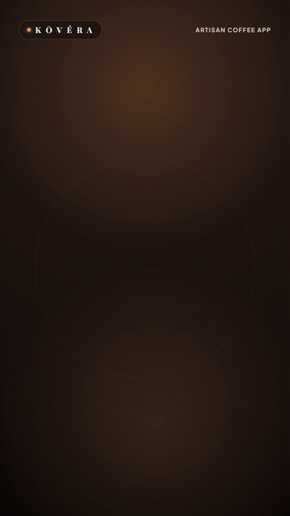
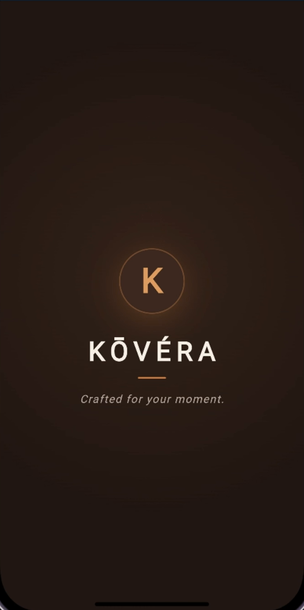
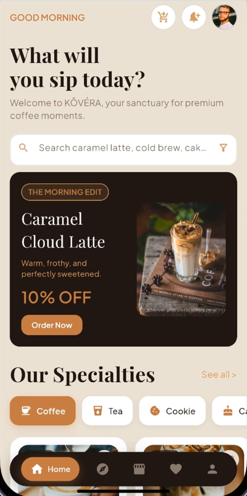
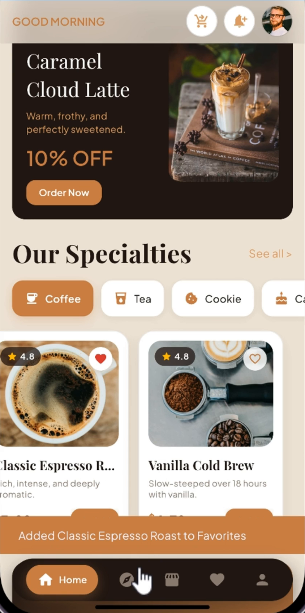
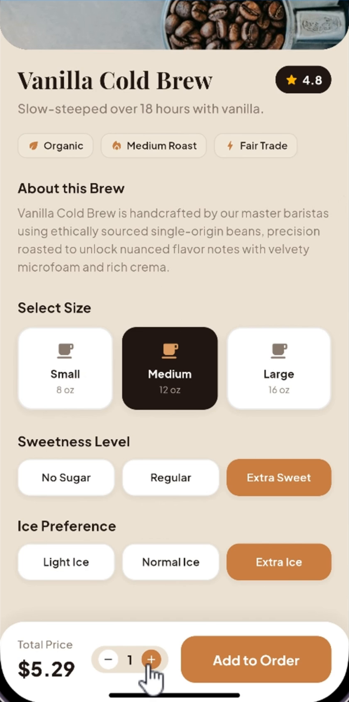
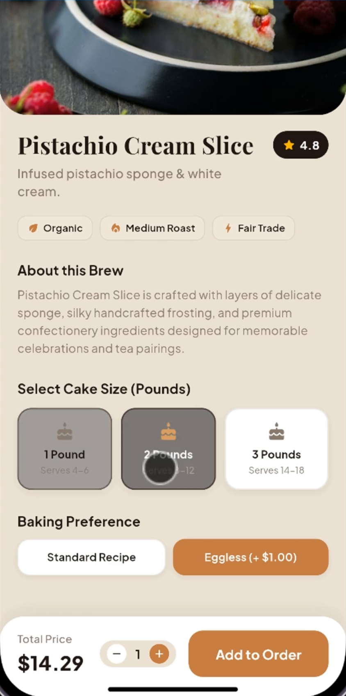
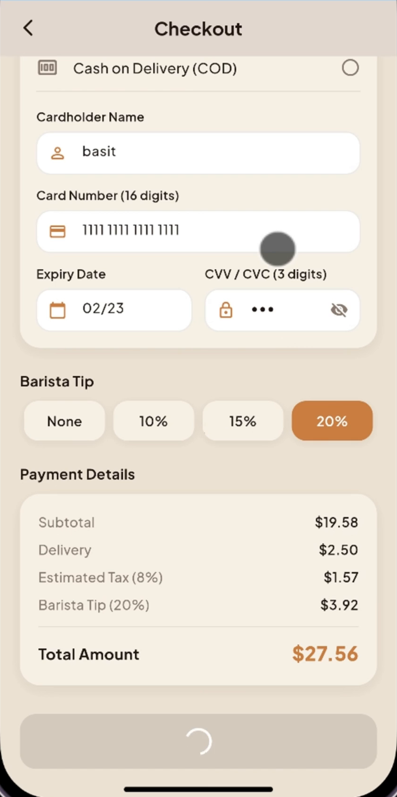

# ☕ KŌVÉRA — Artisan Coffee & Bakery Mobile Experience

<p align="center">
  
</p>

<p align="center">
  <b>Your sanctuary for premium coffee moments, bespoke brew crafting, and freshly baked treats.</b><br>
  Crafted with Flutter, Dart & Firebase for iOS and Android.
</p>

<p align="center">
  
  
  
  
  
</p>

---

## 🎬 20-Second Official App Launch Video

Watch the official 20-second vertical (`9:16`) launch showcase featuring the real **KŌVÉRA** application in action:

<p align="center">
  <!-- Native Video Player for GitHub / Web Browsers -->
  <video src="docs/media/kovera-launch.mp4" width="380" controls poster="docs/media/kovera-launch.jpg">
    <a href="docs/media/kovera-launch.mp4">
      
    </a>
  </video>
</p>

<p align="center">
  <i>👉 If inline video playback is restricted in your viewer, <a href="docs/media/kovera-launch.mp4"><b>click here to view/download the full HD 1080×1920 MP4 with Music & SFX</b></a> or preview the animated showcase below:</i>
</p>

<p align="center">
  
</p>

---

## 📱 Real App UI Showcase

**KŌVÉRA** pairs editorial serif typography (*Playfair Display*) with crisp modern UI type (*Plus Jakarta Sans*) across a warm porcelain (`#F6F0E7`), latte mist (`#EDE2D5`), deep espresso (`#201613`), and burnt caramel (`#C47A45`) palette:

### ☕ Storefront & Curated Discovery

| Brand Splash Experience | Morning Sanctuary Storefront | Explore & Seasonal Collections |
| :---: | :---: | :---: |
|  |  |  |
| *"Crafted for your moment."* | *Morning Edit & specialty categories* | *Autumn Vibes & curated collections* |

### 🥐 Bespoke Customization & Seamless Checkout

| Beverage Customizer (Cold Brew) | Bakery Customizer (Artisan Cake) | Instant Checkout & Confirmation |
| :---: | :---: | :---: |
|  |  |  |
| *Size (8/12/16 oz), sweetness & ice* | *Cake weight (1–3 lbs) & eggless options* | *Pickup/Delivery, barista tip & confirmation* |

---

## ✨ Core Features & Highlights

- **🏠 Glassmorphic Sanctuary Home Screen**:
  - Scroll-reactive `BackdropFilter` header that smoothly transitions from transparent tofrosted glass as you scroll.
  - *"The Morning Edit"* promotional hero card and quick category filtering across **Coffee**, **Tea**, **Cookie**, and **Cake**.
  - Instant real-time search with dynamic result counts and empty-state feedback.
- **☕ Category-Aware Product Customizer**:
  - **Beverages (Coffee & Tea):** Cup size selector (`Small 8 oz`, `Medium 12 oz`, `Large 16 oz`), Sweetness Level (`No Sugar`, `Regular`, `Extra Sweet`), and Ice Preference (`Light Ice`, `Normal Ice`, `Extra Ice`).
  - **Artisan Cookies:** Weight selector (`100g`, `250g`, `500g`) and packaging option (`Standard Box` vs. `Artisan Tin`).
  - **Celebration Cakes:** Pound size selector (`1 Pound`, `2 Pounds`, `3 Pounds`) and baking preference (`Standard Recipe` vs. `Eggless`).
- **🔍 Explore & Curated Collections**:
  - One-tap popular search tags (*Espresso*, *Caramel*, *Latte*, *Cheesecake*, *Cookie*, *Cold Brew*).
  - Horizontal *Seasonal Editions* showcase (*Autumn Vibes — Warm & Cozy*).
- **🔐 Firebase Authentication & Cloud Sync**:
  - Email & Password Sign-In / Sign-Up, Google Sign-In, and Password Reset flows.
  - Cloud Firestore integration (`FirestoreService`) isolating user profiles (`/users/{uid}`), favorites (`/users/{uid}/favorites`), and order history (`/users/{uid}/orders`).
- **💳 Smart Checkout & Barista Tipping**:
  - Toggle between **Store Pickup** (with custom pickup instructions) and **Delivery** (`$2.50` fee with street/city address validation).
  - Supports **Apple Pay**, **Credit / Debit Card** (with 16-digit formatting, `MM/YY` validation, and obscured CVV toggle), and **Cash on Delivery**.
  - Interactive Barista Tip selector (`None`, `10%`, `15%`, `20%`) with live tax and total calculation.

---

## 🎨 KŌVÉRA Design System

| Token | Hex | Role |
| :--- | :--- | :--- |
| `deepEspresso` | `#201613` | Primary brand dark surface & editorial headlines |
| `roastedCocoa` | `#3A2721` | Secondary dark surface & club membership accents |
| `burntCaramel` | `#C47A45` | Primary interactive CTA, active pills & highlights |
| `softAmber` | `#D99A63` | Warm secondary accent, badges & icon highlights |
| `warmPorcelain` | `#F6F0E7` | Elevated card surfaces & light text on espresso |
| `latteMist` | `#EDE2D5` | Primary warm canvas background |

---

## 🛠️ Tech Stack & Architecture

- **Framework:** [Flutter](https://flutter.dev/) (SDK `^3.12.2`)
- **Language:** [Dart](https://dart.dev/)
- **Backend & Cloud:** [Firebase Auth](https://firebase.google.com/docs/auth), [Cloud Firestore](https://firebase.google.com/docs/firestore), [Google Sign-In](https://pub.dev/packages/google_sign_in)
- **Typography:** [Google Fonts](https://pub.dev/packages/google_fonts) (*Playfair Display* & *Plus Jakarta Sans*)
- **Launch Video Engine:** `/brag` + [Hyperframes](https://github.com/heygen-com/hyperframes) HTML/GSAP composition (`brag-output/`)

```text
lib/
├── core/
│   ├── data/
│   │   └── app_data.dart                # Curated coffee, tea, cookie & cake catalog
│   ├── services/
│   │   ├── auth_service.dart            # Firebase Auth & Google Sign-In service
│   │   ├── cart_service.dart            # Reactive cart state management
│   │   ├── favorite_service.dart        # Reactive wishlist synced with Firestore
│   │   └── firestore_service.dart       # Per-user Firestore profile, favorites & orders
│   └── themes/
│       └── colors.dart                  # KŌVÉRA centralized color tokens
├── models/
│   ├── cart_item.dart                   # Cart item model with quantity & total calculation
│   └── favorite_item.dart               # Favorite item model
├── Screens/
│   ├── splash/splash_screen.dart        # Animated KŌVÉRA brand splash screen
│   ├── onboarding/onboarding_screen.dart# 3-step luxury editorial onboarding
│   ├── login/
│   │   ├── login_screen.dart            # Email & Google Sign-In screen
│   │   └── signup_screen.dart           # Account registration screen
│   ├── Home/home_screen.dart            # Glassmorphic storefront & live search
│   ├── Explore/explore_screen.dart      # Popular searches & seasonal collections
│   ├── ProductDetail/                   # Category-adaptive brew & bakery customizer
│   ├── Shop/shop_screen.dart            # Order bag & item quantity management
│   ├── Checkout/checkout_screen.dart    # Pickup/Delivery, card validation & tipping
│   ├── Favorite/favorite_screen.dart    # Saved blends & treats
│   └── Profile/profile_screen.dart      # KŌVÉRA Club membership & account settings
├── widget/                              # Reusable UI components & floating bottom nav
└── main.dart                            # Application entry point & Firebase initialization
```

---

## 🚀 Getting Started

### 1. Prerequisites

- [Flutter SDK](https://docs.flutter.dev/get-started/install) (`^3.12.2`)
- Android Studio / Xcode / VS Code with Flutter & Dart plugins

### 2. Clone & Run

```bash
# Clone the repository
git clone https://github.com/CodeWith-Basit/coffee_app.git
cd coffee_app

# Install dependencies
flutter pub get

# Run the app on your connected device or emulator
flutter run
```

---

## 👨‍💻 Author & Credits

- **Developer:** [Abdul Basit (@CodeWith-Basit)](https://github.com/CodeWith-Basit)
- Crafted with passion using **Flutter & Firebase** ☕
